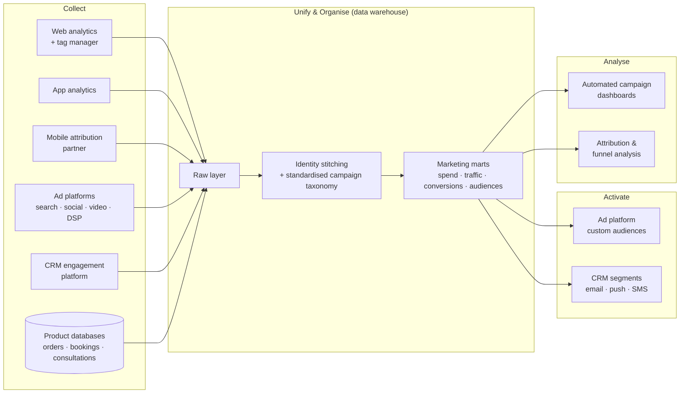
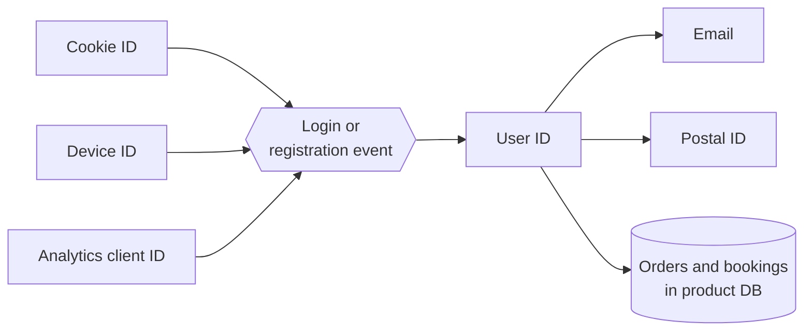

# Marketing data integration, attribution and audience activation

**Type:** Data architecture plan · **My role:** Data analyst (data architecture), author of the plan · **Stack:** Web and app analytics, mobile attribution, ad platforms, CRM, AWS data warehouse

## Context

A consumer digital platform with several product lines (marketplace, appointment booking, online consultations, and content and community), available on web and mobile app. Growth relied on paid acquisition across search, social, app-install, video and programmatic campaigns, and on CRM messaging (email, push, in-app and SMS) for existing users.

## The problem

Once the marketing platforms were connected, the data still did not work together:

- **Scattered data.** Results lived in each platform's own dashboard and in spreadsheets, so there was no single view of spend, traffic and conversions.
- **CRM disconnected from attribution.** CRM data was not linked to the mobile attribution data, so retention campaigns and acquisition campaigns could not be evaluated together.
- **No standards.** Campaign naming, metrics and UTM source/medium values were inconsistent across teams, so conversions went unattributed.
- **Last-click only.** Every earlier touchpoint in the journey got no credit, and cross-device journeys (ad seen on mobile, purchase on web) were invisible.
- **No way back out.** Audiences could not be sent from the warehouse to the channels (ad platforms, CRM) that needed them.

## Objectives

1. Unify all marketing and product data in one warehouse (data stitching).
2. Reconcile platform-reported conversions with **actual** conversions from the product database.
3. Move from last-click to multi-channel, cross-device attribution.
4. Build audience segments and profiles, and activate them in every channel.
5. Automate campaign reporting so analysts spend time on insight, not on copying numbers.

## Architecture

The plan follows five stages: **Collect → Unify → Organise → Activate → Analyse**.

### Identity stitching

The core of the design is connecting anonymous behaviour to known customers, so a journey that starts with an ad on one device and ends with a purchase on another can be measured as one journey.

## Audience scheme

Two engagement models, each with its own identifiers and purpose:

| | Direct engagement | Passive engagement |
|---|---|---|
| **Platform** | CRM | Data management platform (DMP) |
| **Users** | Existing, known customers | Anonymous visitors and new acquisition |
| **Channels** | Email, push notification, in-app banner, SMS | Display, app campaigns, video, social media |
| **Identifiers** | User ID, email, postal ID | Cookies, device ID, client ID |
| **Used for** | RFM segmentation (recency, frequency, monetary value), retention | Media buying, content personalisation, audience analytics |

Data sources are classified by origin: **first-party** (own customers), **second-party** (shared through partnerships) and **third-party** (pre-packaged external segments).

## Data model

Reporting dimensions are organised in two levels so the same model serves both management and campaign managers:

| Level | Dimensions |
|---|---|
| **Upper view** (management) | Product line · Paid / owned / earned media · Channel · Site (web or app) |
| **Lower view** (campaign managers) | Product category · Campaign · Ad set · Content |

Metrics combine three sources that were previously never joined:

- **Pre-click:** impressions, clicks, cost (ad platforms)
- **Post-click:** sessions, events, funnel steps (web and app analytics)
- **Actual outcomes:** orders, bookings, consultations (product database)

## Attribution

Moving off last-click meant choosing what to replace it with. I compared four models:

| Model | Strength | Weakness |
|---|---|---|
| Last-click | Simple, and everyone understands it | Ignores every touchpoint before the last one |
| Position-based | Built into the analytics tool | Weights are arbitrary, so channels can get more credit than they earned |
| Assisted conversions | Shows how channels support each other | Double-counts, so credit adds up to more than the conversions |
| Data-driven | Uses every session in the journey | A black box, and only as good as the analytics data under it |

The data-driven model depends on consistent tracking. So the plan put the foundations first: an audit of analytics and tag-manager tracking, a standardised UTM and campaign taxonomy, and identity stitching. Only after those comes multi-channel, cross-device and online-to-offline attribution.

## Workstreams

1. Analytics audit: web analytics and tag-manager configuration
2. Data consolidation and consistency across sources
3. Multi-channel, cross-device and omnichannel attribution
4. Connecting online channels to offline outcomes
5. Grouping, categorising and clustering users
6. Automated reporting for campaign management
7. Audience segmentation and profiling, including cross-device
8. Insight for the business plan

## Outcome

The plan was partly implemented before I left the company. Booking and marketplace reporting moved from manual updates to automated pipelines (see the [warehouse case study](../02-data-warehouse-modernisation/#outcome)), and I handed the remaining work over to the data engineer.

## What this shows

- Translating a messy marketing-tech landscape into a layered warehouse design
- Identity resolution across anonymous and known users
- A dimensional model that serves both executives and campaign managers
- Weighing attribution models on their trade-offs instead of defaulting to the tool's setting

---

*Company name, internal system and product names, people and figures have been removed, and all diagrams are redrawn. Details are generalised to respect confidentiality.*
