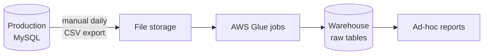
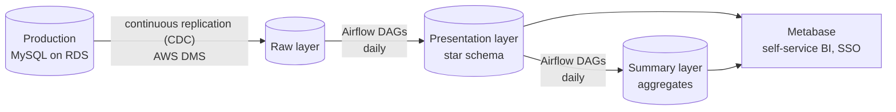
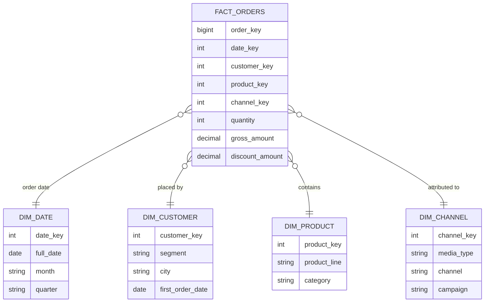

# Data warehouse modernisation

**Type:** Team project (data team) · **My role:** Data analyst (data architecture). I designed the dimensional data model and built this plan into the wider business data architecture roadmap · **Stack:** AWS RDS (MySQL), AWS DMS, Apache Airflow, star schema, Metabase

## Context

The same multi-product consumer platform kept its production data in MySQL databases on AWS. The analytics warehouse was fed by a manual daily process, and was becoming the bottleneck for every report described in the [marketing data integration case study](../01-marketing-data-integration/).

## The problem

1. **Manual ingestion.** Data was exported from production to CSV files every day and loaded by hand. This doesn't scale.
2. **Schema drift.** Changes to production tables were not reflected in the warehouse, risking silent data loss.
3. **Vendor lock-in.** The ETL ran on AWS Glue, a proprietary service, which would make a future move to another provider harder.
4. **No standardisation.** After the raw layer there was no cleansing or deduplication logic.
5. **No data model.** Tables were not organised as a star or snowflake schema, so every analysis started from raw tables.

## Before and after

**Before**

**After**

## Design decisions

| Decision | Chosen | Why | Trade-off accepted |
|---|---|---|---|
| Ingestion | Continuous replication with AWS DMS | Copies changes record by record, so production load stays minimal and schema changes come through automatically | Keeps AWS lock-in at the ingestion layer, accepted for speed since all sources were already on AWS |
| Orchestration | Apache Airflow, replacing Glue | Open source and portable; handles dependencies, backfills by date, retries and alerting; pipelines are versioned as code | The team runs and maintains the Airflow server itself |
| Modelling *(my part)* | Star schema | Simple design and fast queries: one join from a fact table to any dimension | More redundancy than a snowflake schema |
| BI | Metabase | Open source self-service exploration with access control by role and single sign-on | Less advanced than commercial BI tools |
| Security | Airflow reachable over VPN only | Pipelines and credentials are not exposed to the internet | Access needs the VPN |

## Warehouse layers

| Layer | Contents | Built by |
|---|---|---|
| **Raw** | Replicated production tables, latest schema | AWS DMS |
| **Presentation** | Fact and dimension tables (star schema), cleaned and deduplicated | Airflow, daily |
| **Summary** | Pre-aggregated tables for dashboards | Airflow, daily |

### Example star schema (illustrative)

The real schema is confidential. This shows the pattern for one business process:

## Rollout plan

| Milestone | Scope | Planned time |
|---|---|---|
| 1. Continuous ingestion | Configure source and target endpoints and replication jobs for each production table | 1 week |
| 2. Airflow | Host Airflow on a server reachable only over VPN, add source connectors, set up a subdomain | 1 week |
| 3. Glue → Airflow, with modelling | Design the star schema from the existing Glue tables; daily DAGs from raw to presentation to summary | 3 weeks |
| 4. Self-service BI | Host Metabase, connect it to the warehouse, enable single sign-on for company accounts | 1 week |

Six weeks in total, sequenced so that each milestone delivers something usable on its own.

## Outcome

The plan was partly implemented before I left the company:

- **Booking reports** moved from manual updates by customer service to a daily automated pipeline.
- **Marketplace reporting** (merchant registrations, catalogue listings and platform activity) also moved to a daily automated pipeline.

I handed the remaining work over to the data engineer.

## What this shows

- Diagnosing pipeline problems: scale, schema drift, lock-in, missing modelling
- Choosing where vendor lock-in is acceptable and where it isn't
- Layered warehouse design (raw → presentation → summary) with dimensional modelling
- Planning a migration in small, independently useful milestones

---

*Company name, internal system names, people, ticket references and figures have been removed. The schema shown is illustrative, not the production schema.*
